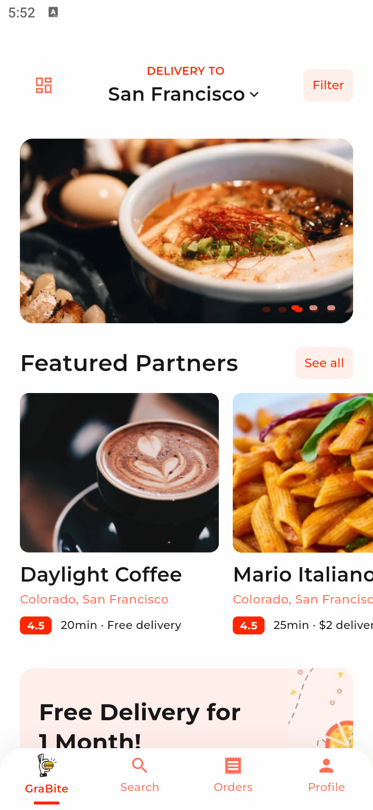
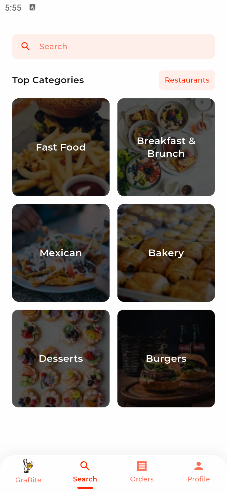
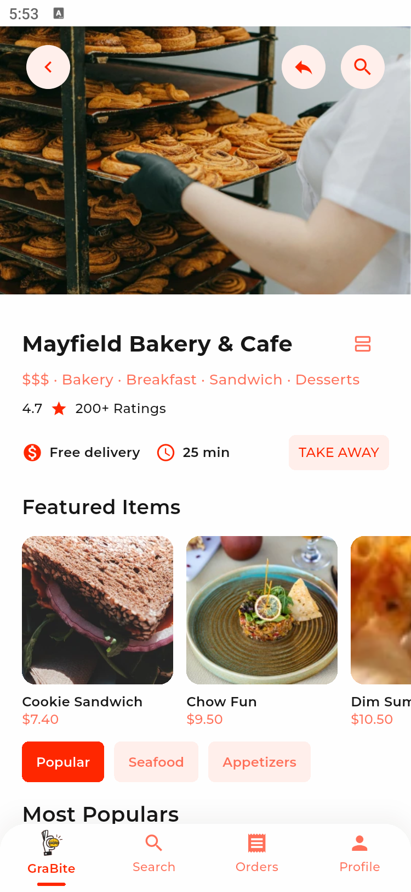
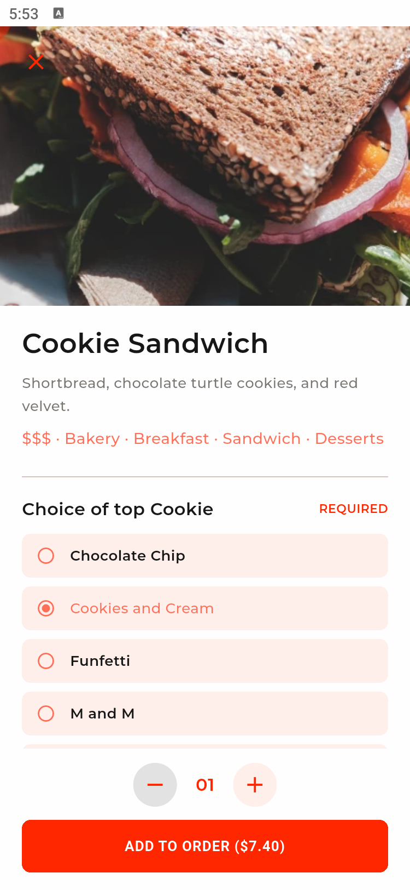
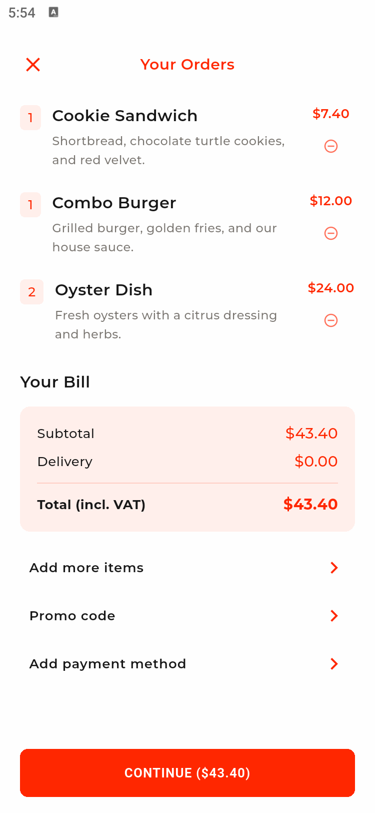
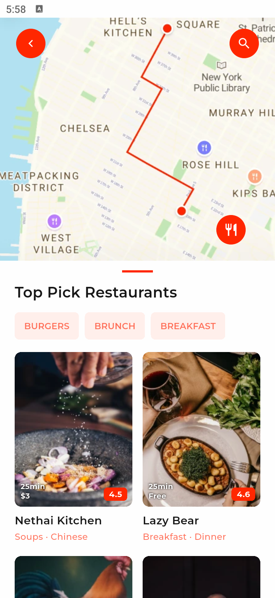

# GraBite · Flutter 美食点餐与配送

根据 Pixso 的「GraBite - Food Ordering or Delivery App UI Kit - Ui8 File」实现的 Android Flutter 演示。通过 MCP 读取 `UI Screens` 中的 54 个画板，并在共用组件中实现引导、浏览、搜索、点餐、账户和附近餐厅。

## 主要界面

| 推荐首页 | 美食分类 | 餐厅菜单 |
| --- | --- | --- |
|  |  |  |

| 菜品规格与数量 | 购物车 | 附近餐厅地图 |
| --- | --- | --- |
|  |  |  |

默认启动样式为珊瑚色，白色和黑色启动变体可在截图索引中查看。每个画板的模拟器截图、Pixso 节点 ID 和设计尺寸见 [54 个界面的截图索引](docs/SCREENS.md)。

## 体验流程

| 模块 | 本地演示内容 |
| --- | --- |
| 登录与地址 | 三步引导、登录和注册校验、忘记密码、验证码、配送城市选择与地址输入 |
| 浏览与搜索 | 四种首页布局、餐厅菜单、搜索历史、分类、排序、价格和饮食筛选 |
| 点餐与订单 | 规格选择、备注、数量、购物车、运费优惠码、账单、下单结果和订单记录 |
| 账户与支付 | 编辑资料、通知开关、卡片表单及扫描预览、社交账号选择、分享链接复制 |
| 附近餐厅 | 示例地图、餐厅列表、评分和评论 |

完成引导后，可用 `demo@example.com` 和 `demo123` 登录。手机号登录使用演示验证码 `4444`。从首页左上角切换布局，点餐厅与菜品可加入购物车。购物车支持示例优惠码 `FREEDELIVERY`，添加支付方式时可点 **Use demo card** 填写测试数据。

应用使用本地演示数据。登录、邮件、短信、定位、地图、支付、扫描和社交账号操作均为模拟。资料、选定配送位置、登录标记和通知偏好储存在本机。购物车、订单和卡片标签保存在当前会话内，支付表单和密码仅用于当次输入。

## 项目结构与架构

```text
GraBiteAFoodOrderDelivery/
├── lib/
│   ├── main.dart                 # 初始化系统样式和本机偏好
│   ├── app.dart                  # Material 主题和页面路由
│   ├── core/
│   │   ├── state.dart            # 会话状态、购物车、筛选和偏好
│   │   └── ui.dart               # 色板、排版、导航、表单和共用组件
│   ├── data/catalog.dart         # 餐厅、菜品、城市与筛选数据
│   └── features/
│       ├── auth.dart             # 引导、登录、注册和地址
│       ├── discovery.dart        # 首页、餐厅列表、搜索
│       ├── filters.dart          # 首页快捷筛选和综合筛选
│       ├── ordering.dart         # 餐厅菜单、购物车和订单
│       ├── account.dart          # 设置、支付和邀请
│       └── nearby.dart           # 地图和餐厅评价
├── assets/                       # WebP 图片、Montserrat 字体和许可
├── android/                      # Android 工程与启动图标
├── docs/                         # 截图索引和 Android PNG 截图
├── test/                         # 登录、下单、支付、筛选和本机偏好验证
└── tool/                         # 截图专用入口、画板映射和采集脚本
```

`GraBiteApp` 使用 Flutter `Navigator` 路由到功能页。页面从 `GraBiteScope` 订阅 `GraBiteState`，共享购物车、账户偏好和搜索筛选状态。清单数据位于 `catalog.dart`，两种餐厅菜单、列表和网格布局复用相同数据与卡片组件。启动、确认和弹层画板使用同一套页面组件。唯一额外运行时依赖是 `shared_preferences`。

## 本地运行与验证

验证环境为 Flutter 3.47.7、Dart 3.13.5 和已有的 Android 11 x64 模拟器 `emulator-5554`。Android 构建使用本机已有的 Gradle 8.14 和 Android Gradle Plugin 8.13.1。

静态检查与 5 项自动测试通过。常规入口已在模拟器验证引导、登录、选择地址、餐厅加购、结账和查看订单。

```powershell
flutter pub get
flutter devices
flutter run -d emulator-5554
flutter analyze
flutter test --concurrency=1
```

在 Windows 上可重新采集截图。脚本在已有 x64 模拟器上临时使用 375 × 812 逻辑尺寸，完成后恢复设备原始显示配置。截图入口使用样例数据打开指定画板，日常运行从 `lib/main.dart` 进入。

```powershell
.\tool\capture.ps1 -Device emulator-5554
flutter run -d emulator-5554
```

原始导出稿位于项目内的 `All Screens/`。运行时只加载 `assets/` 中的独立素材。
